# Prato Circular


Projeto: Prato Circular

Integrantes:

- Kevin Bueno — RM 556761
- Carolina Seiko Biadola de Deus — RM 558839
- Sophia Barnabé Alves das Neves — RM 558267

Disciplina: Desenvolvimento Cross-Platform com Flutter

Global Solution 2026.2 — CitizenTech

## Sobre o projeto

O Prato Circular é um aplicativo CitizenTech desenvolvido para reduzir o desperdício de alimentos e facilitar a conexão entre estabelecimentos com excedentes próprios para consumo e ONGs interessadas em realizar a retirada.

Padarias, restaurantes, mercados e outros estabelecimentos podem cadastrar alimentos disponíveis, informando quantidade, validade e horário de retirada. As ONGs podem consultar as doações, visualizar detalhes, favoritar e reservar alimentos disponíveis.

O aplicativo possui dois perfis:

### Fornecedor

- Cadastro e login
- Consulta de endereço pelo CEP
- Cadastro de doações
- Listagem de doações
- Edição de doações
- Exclusão com confirmação
- Acompanhamento de reservas
- Confirmação de retirada
- Indicadores de impacto

### ONG

- Cadastro e login
- Consulta de endereço pelo CEP
- Listagem de doações
- Busca por alimento ou fornecedor
- Visualização dos detalhes
- Favoritos
- Reserva de alimentos
- Indicadores de impacto

## CitizenTech e ODS

O Prato Circular coloca cidadãos, estabelecimentos e instituições no centro da solução, criando uma rede local para reaproveitamento de alimentos.

O projeto está relacionado principalmente a:

- ODS 2 — Fome Zero e Agricultura Sustentável
- ODS 12 — Consumo e Produção Responsáveis

## Funcionalidades do MVP

- Splash Screen
- Onboarding
- Login
- Cadastro de usuário
- Perfis Fornecedor e ONG
- Consulta de CEP pela API ViaCEP
- Home com indicadores consumidos pelo Provider
- Identificação dos ODS na Home
- Tela de listagem com ListView
- Loading
- Tratamento de lista vazia
- Tratamento de erro
- Busca de doações
- Cadastro de doação
- Edição de doação
- Exclusão com AlertDialog
- Tela de detalhes
- Favoritos
- Reserva
- Confirmação de retirada
- Minhas doações
- Perfil
- Indicadores de impacto
- Logout

## CRUD

O CRUD principal é realizado sobre as doações:

- Create: cadastro de nova doação
- Read: listagem e detalhes das doações
- Update: edição dos dados da doação
- Delete: exclusão da doação com confirmação

## Arquitetura

O projeto utiliza uma estrutura simples, separada em:

```text
lib/
├── models/
├── providers/
├── screens/
├── services/
├── widgets/
└── main.dart
```


## Persistência escolhida

O projeto utiliza persistência local assíncrona com `shared_preferences`, armazenando os dados em JSON no próprio dispositivo.

São persistidos:

- usuários cadastrados
- sessão do usuário
- estado do onboarding
- doações
- favoritos
- status das doações

Todas as operações de leitura e gravação são realizadas de forma assíncrona com Future, async e await.

A solução não exige banco externo, servidor local, chave privada ou configuração manual, mantendo a execução zero-config.

## API HTTP

A API ViaCEP é utilizada somente como recurso complementar para preencher os dados de endereço durante o cadastro do usuário.

Exemplo de endpoint:

```text
https://viacep.com.br/ws/01001000/json/
```

A consulta utiliza:

- package:http
- GET
- Future
- async
- await
- statusCode
- jsonDecode

O CRUD principal não depende da API e funciona localmente.

## Telas principais

O fluxo contém mais de cinco telas:

1. Splash
2. Onboarding
3. Login
4. Cadastro de usuário
5. Home / Dashboard
6. Todas as doações
7. Cadastro e edição de doação
8. Detalhes da doação
9. Minhas doações
10. Favoritos
11. Impacto
12. Perfil

## Formulários e validações

O projeto utiliza:

- Form
- GlobalKey<FormState>
- TextFormField
- validator
- feedback com SnackBar
- confirmação de exclusão com AlertDialog

Os formulários impedem o envio de campos obrigatórios vazios, e-mail inválido, senha inválida e quantidade menor ou igual a zero.

## Navegação

A navegação utiliza Navigator.push e Navigator.pop com MaterialPageRoute.

O identificador da doação é enviado para a tela de detalhes e para o formulário de edição.

## Testes de unidade

O projeto possui 12 testes de unidade na pasta `test/`.

Os testes validam:

- campos obrigatórios
- e-mail
- senha
- quantidade
- números decimais
- comportamento do model Donation
- conversão para Map
- copyWith

Execute:

```bash
flutter test
```
## Galeria de Telas

### 1. Splash 1
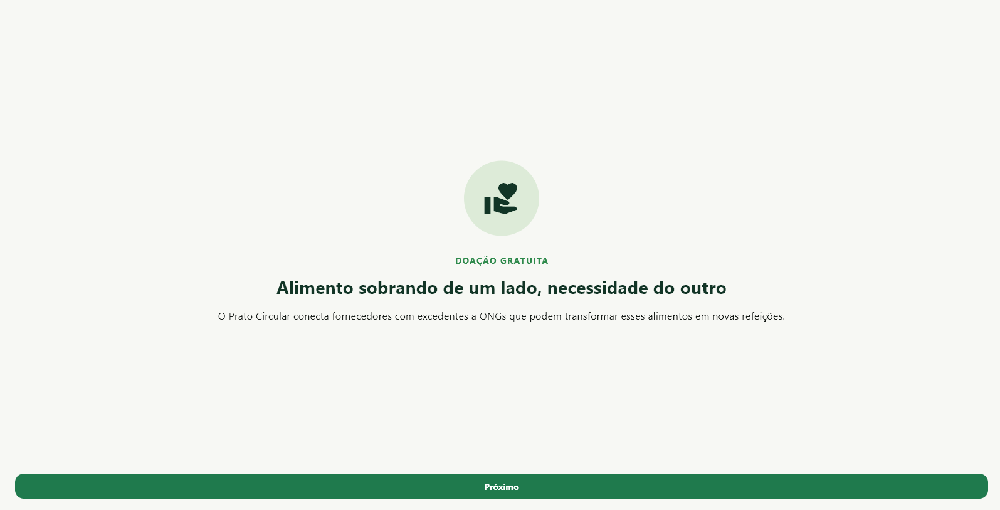

### 2. Splash 2
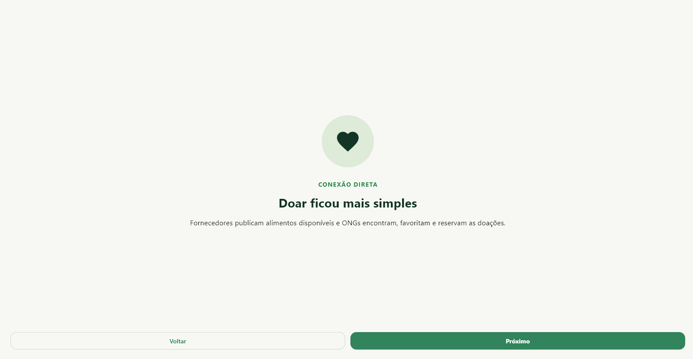

### 3. Splash 3
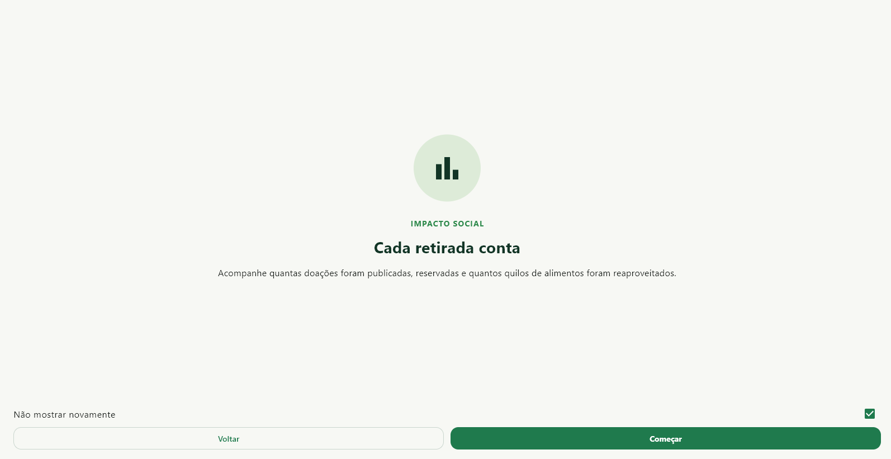

### 4. Login
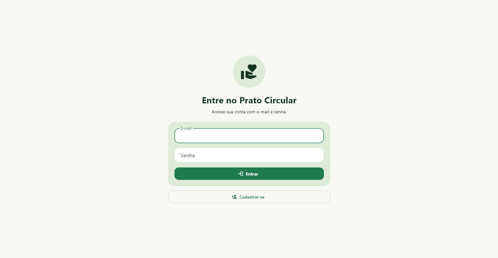

### 5. Cadastro
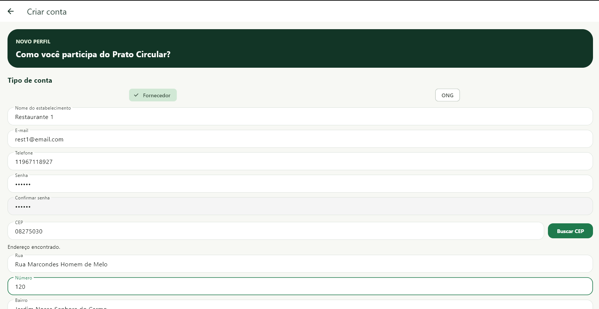

### 6. Cadastro - Endereço
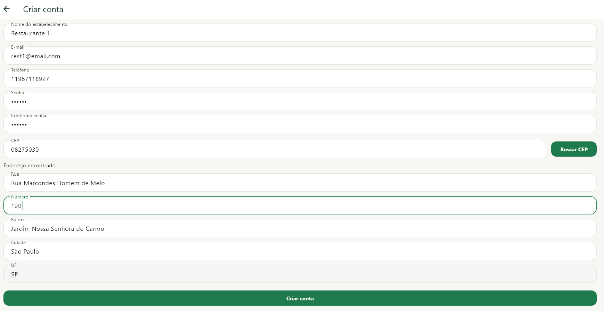

### 7. Home - Fornecedor
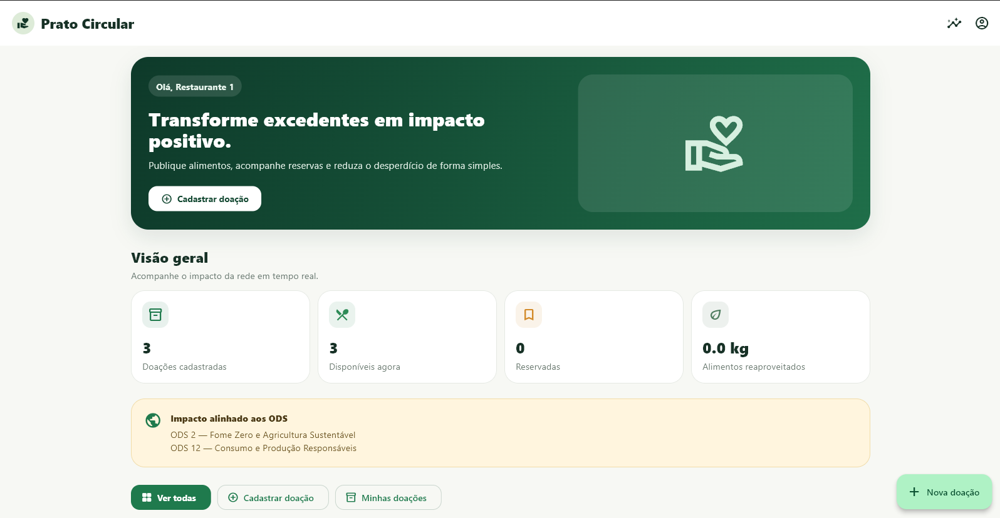

### 8. Home - Fornecedor - Resumo
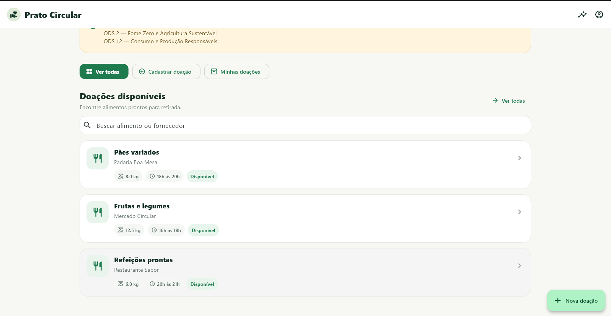

### 9. Home - ONG
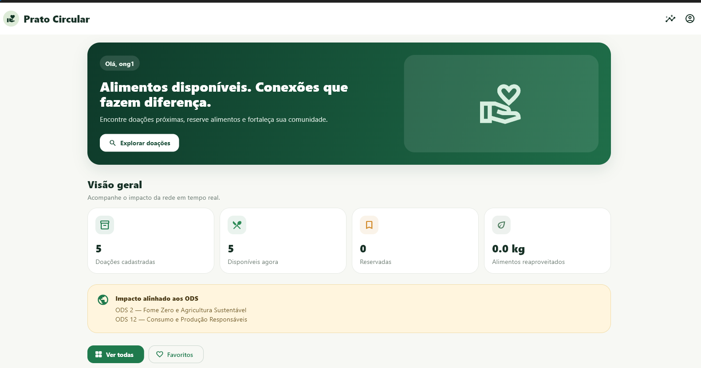

### 10. Todas as Doações
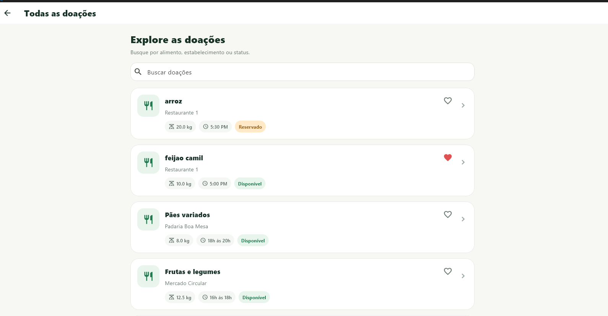

### 11. Cadastro de Doação
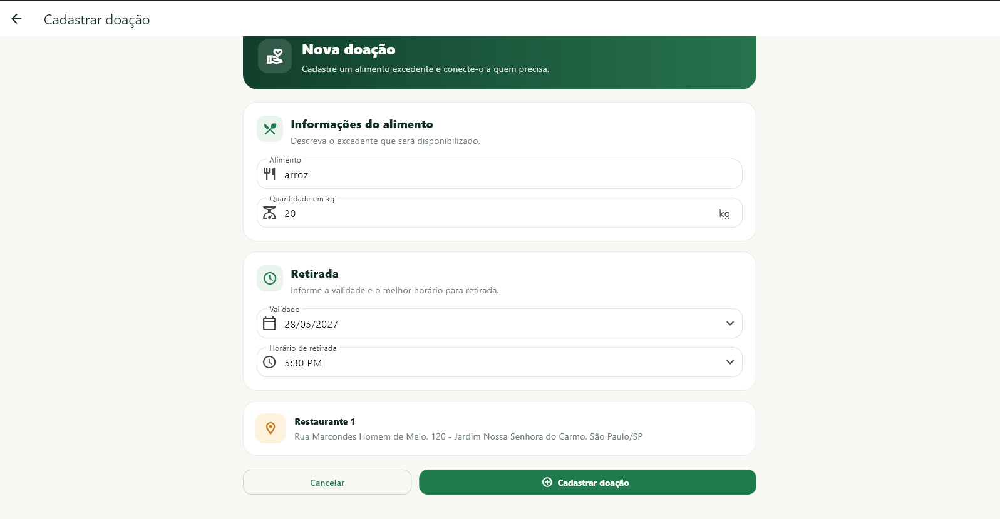

### 12. Detalhes da Doação
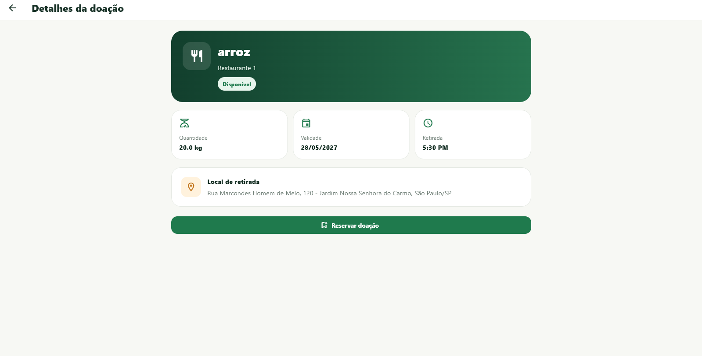

### 13. Favoritos
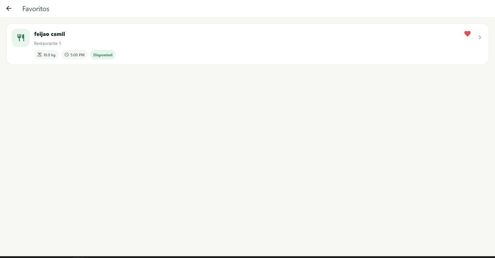

### 14. Impacto
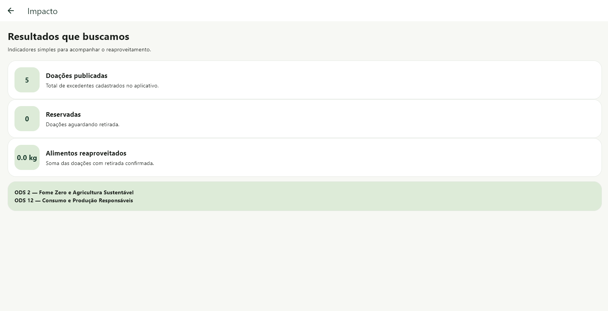

### 15. Impacto - Indicadores
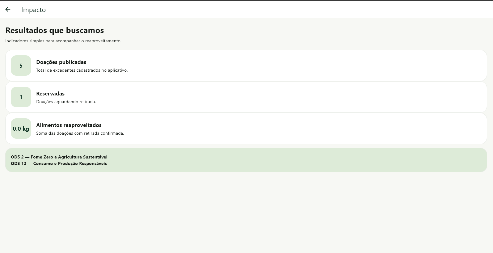

### 16. Perfil
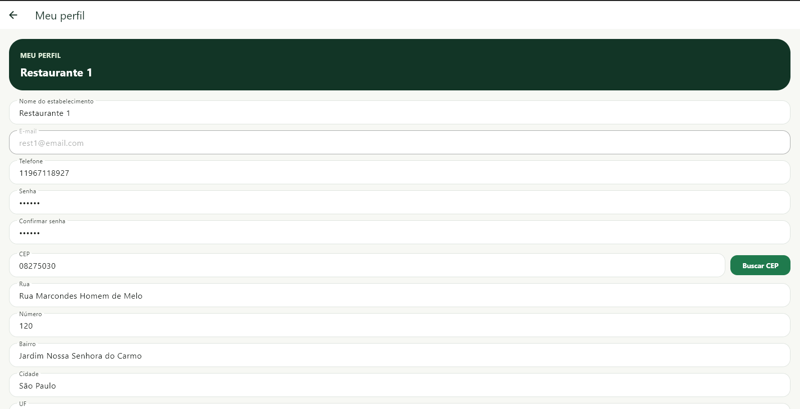
